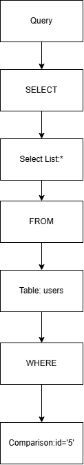
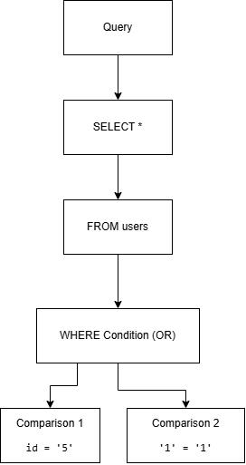

# SQL Injection Detection: Parse Trees

## 1. Introduction

A parse tree represents the grammatical structure of an SQL query.
In this project, parse trees help explain the differences between
normal SQL queries and queries containing suspicious conditions.

## 2. Normal SQL Query

Example:

SELECT * FROM users WHERE id = '5';

### Simplified Parse Tree

```text
Query
└── Select
    ├── SelectList
    │   └── Star (*)
    ├── From
    │   └── Table (users)
    └── Where
        └── Comparison
            ├── Column (id)
            ├── Operator (=)
            └── String ('5')
```

### Parse Tree Diagram



## 3. SQL Injection Example

Example of a query containing a suspicious condition:

```sql
SELECT * FROM users WHERE id = '5' OR '1' = '1';
```

This query contains an `OR` condition that is always true because the string `'1'` equals itself. In an application that constructs SQL by concatenating untrusted input, similar conditions can alter the intended filtering logic.

### Simplified Parse Tree

```text
Query
└── Select
    ├── SelectList
    │   └── Star (*)
    ├── From
    │   └── Table (users)
    └── Where
        └── Condition (OR)
            ├── Comparison
            │   ├── Column (id)
            │   ├── Operator (=)
            │   └── String ('5')
            └── Comparison
                ├── String ('1')
                ├── Operator (=)
                └── String ('1')
```

### Parse Tree Diagram



## 4. Comparison Between Normal and Suspicious Queries

- **Normal query:** Uses a single comparison to filter records by the specified user ID.
- **Suspicious query:** Adds an `OR` condition that is always true, potentially changing the filtering logic.
- **Parse-tree difference:** The normal query has one comparison under `WHERE`, while the suspicious query has two comparisons combined by `OR`.
- **Detection limitation:** A parse tree shows query structure, but it cannot prove malicious intent by itself. The detector must apply the project's actual detection rules.

These examples illustrate how parse trees can help explain structural differences between SQL queries.
