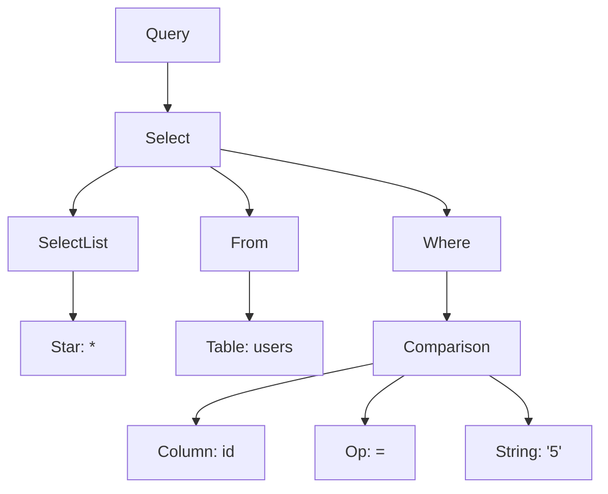
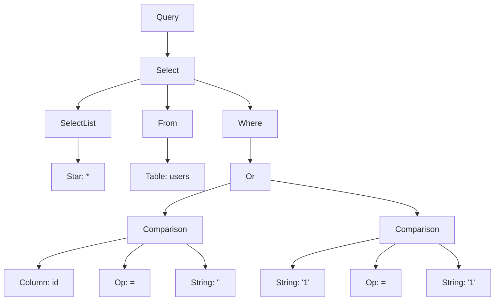

# Parse Trees: Normal vs. Injected Queries

Generated by `generate_docs.py` from the project's parser.

## Query 1 — Normal

`SELECT * FROM users WHERE id = '5'`

**Verdict:** SAFE
**Why:** The WHERE clause contains a single equality condition.

```text
Query
└── Select
    ├── SelectList
    │   └── Star: *
    ├── From
    │   └── Table: users
    └── Where
        └── Comparison
            ├── Column: id
            ├── Op: =
            └── String: '5'
```

### Mermaid diagram

Paste this code into draw.io using **Arrange → Insert → Advanced → Mermaid**.



## Query 2 — Injected (Tautology)

`SELECT * FROM users WHERE id = '' OR '1'='1'`

**Verdict:** INJECTION DETECTED
**Why:** The WHERE clause contains an OR branch with a constant comparison, `'1' = '1'`, that is always true.

```text
Query
└── Select
    ├── SelectList
    │   └── Star: *
    ├── From
    │   └── Table: users
    └── Where
        └── Or
            ├── Comparison
            │   ├── Column: id
            │   ├── Op: =
            │   └── String: ''
            └── Comparison
                ├── String: '1'
                ├── Op: =
                └── String: '1'
```

### Mermaid diagram



## Query 3 — Injected (OR + Comment)

`SELECT * FROM users WHERE id = '' OR 1=1--`

**Verdict:** INJECTION DETECTED
**Why:** The SQL comment can hide the remainder of a query, and the OR branch contains the always-true comparison `1 = 1`.

```text
Query
└── Select
    ├── SelectList
    │   └── Star: *
    ├── From
    │   └── Table: users
    └── Where
        └── Or
            ├── Comparison
            │   ├── Column: id
            │   ├── Op: =
            │   └── String: ''
            └── Comparison
                ├── Number: 1
                ├── Op: =
                └── Number: 1
```

### Mermaid diagram


## Key Structural Difference

| Feature | Normal query | Injected query |
|---|---|---|
| WHERE structure | One `Comparison` | `Or` with two branches |
| Conditions | One equality condition | An additional constant comparison |
| Meaning | Selects rows matching the specified ID | The always-true OR condition can make all rows match |
| Scanner result | SAFE | INJECTION DETECTED |

**Conclusion:** The parse tree represents the structure of a SQL query. A normal query has a single equality condition, while these injected examples contain suspicious OR branches and constant comparisons that the detector identifies.
